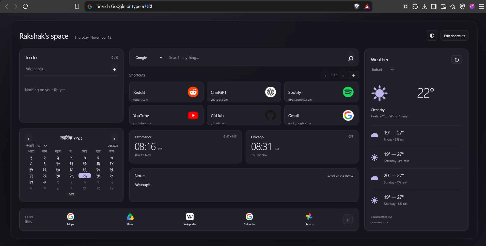

# My Space

A personal new-tab dashboard for Brave. Keep your shortcuts, tasks, notes, weather, and two world clocks together in a compact, dark workspace.

Built by Rakshak with charcoal backgrounds and violet accents. No account, build step, or server is needed to use it.



## Features

- **Editable shortcuts:** add, rename, update, and remove websites. Icons load automatically from the website, with a favicon-service fallback.
- **Saved ordering:** drag shortcuts within either group, or use the Position field in the edit dialog. Position **1** comes first. Main shortcuts are paginated in groups of six.
- **Quick-link dock:** a separate editable group for frequently used destinations.
- **Search:** Google by default, with Brave, YouTube, and DuckDuckGo available.
- **Two clocks:** Kathmandu and Chicago, with timezone and daylight-saving handling.
- **Nepali calendar:** Bikram Sambat dates, month navigation, and an English/Gregorian toggle. The Nepali calendar uses Nepal's current date and works offline.
- **Weather:** Itahari by default, with Kathmandu and Chicago available. Includes current conditions and a four-day forecast in Celsius.
- **Tasks and notes:** add, complete, and delete tasks; notes save as you type.
- **Dark themes:** cycle through violet, blue, and warm accents using the ◐ button.

## Install in Brave

1. Download this repository using **Code → Download ZIP**, then extract it. Alternatively, clone it with Git.
2. Keep the extracted folder somewhere permanent. Brave loads the extension from this folder.
3. Open `brave://extensions` in Brave.
4. Enable **Developer mode**.
5. Click **Load unpacked** and select the folder containing `manifest.json`.
6. Open a new tab. If Brave asks whether to keep the new-tab change, confirm that you want to keep it.

You do **not** need Node.js or `npm install` to use the dashboard. The calendar library is included in `vendor/`.

If another extension replaces your new-tab page, disable that extension first. This project is tested with Brave on Windows; other Chromium browsers may work but have not been verified.

## Make it yours

| Setting | How to change it |
| --- | --- |
| Name in the heading | Open `index.html` and replace `Rakshak&#8217;s space` with your name, such as `Alex&#8217;s space`. |
| Main shortcuts | Use **+** above the shortcut grid. Use **Edit shortcuts** to edit or remove an existing entry. |
| Quick links | Use **+** at the right of the bottom dock. **Edit shortcuts** also enables editing these links. |
| Shortcut order | Drag a card onto another card in the same group. For a move across pages, edit its **Position**. Keyboard users can focus a shortcut and press **Alt + an arrow key** to move it one position. |
| Search engine | Choose an engine from the search dropdown. Your choice is saved. |
| Weather city | Choose Itahari, Kathmandu, or Chicago in the weather dropdown. |
| Calendar | Choose **नेपाली · BS** or **English · AD**. Use the arrows to browse months and **आज / Today** to return. |
| Theme | Click **◐** at the top right. |

After changing source files, click the extension's **Reload** button at `brave://extensions` and open a new tab. Reload the existing extension rather than removing and reinstalling it if you want to retain its saved data.

### Change the clocks or add another weather location

- Clock labels are in `index.html`. The timezone arguments passed to `zoneClock()` inside `tick()` in `app.js` are `Asia/Kathmandu` and `America/Chicago`. Update both the label and its timezone when changing a clock.
- Weather locations are defined in the `cities` object in `app.js`. Add a location with its latitude, longitude, and IANA timezone, then add an option with the matching key to `#weather-city` in `index.html`.
- Styling is in `style.css`. The final theme rules define the current charcoal palettes.

The first run of this version applies Google, Itahari, and the charcoal theme as defaults. Choices made afterward are remembered.

## Storage and network access

Shortcuts, their order, tasks, notes, and preferences are stored in the extension's `localStorage` in your browser profile. They are not uploaded by the dashboard, and they do not sync between devices. Removing the extension or clearing its data can erase them; there is currently no built-in backup/export tool.

The dashboard makes these external requests:

- **Weather:** requests forecasts from [Open-Meteo](https://open-meteo.com/) using the selected city's coordinates. The extension declares access to `https://api.open-meteo.com/*` for this purpose; it does not request your device's location.
- **Website icons:** first requests `/favicon.ico` from the shortcut's website. If that fails, it requests an icon from Google's favicon service using the website's hostname.
- **Search:** sends your query to the selected search engine when you submit it.

Clocks, the calendar, tasks, notes, and shortcut editing work offline. Search, destination websites, and new icon downloads require a connection. Weather refreshes on a 15-minute interval while the page is open and shows a saved forecast when possible if a request fails. You can also refresh it manually with **↻**.

## Troubleshooting

### “My Space” and “Customize Brave” appear at the bottom

These are browser-owned new-tab footer controls, not elements in this dashboard's HTML. Editing the page's CSS cannot remove them. There is no verified, version-independent removal method documented for this project. The `--disable-features=NtpFooter` launch argument discussed during development has **not** been confirmed to remove the footer in the user's Brave session.

### Weather is unavailable

Check your connection, then click **↻**. A blocked or temporarily unavailable Open-Meteo service can prevent updates. If Brave disables the extension after an update adds weather permission, review and accept the permission to re-enable it.

### A shortcut shows initials instead of an icon

Some sites do not expose a usable favicon, and requests can be blocked by the site, browser, or network. Initials are the fallback; the shortcut still works.

### The calendar does not show holidays or festivals

This is a date calendar with BS/AD conversion, not a Panchang or festival service. Conversion is limited to the date table bundled with the library; future calendar corrections may require a library update.

### Layout on small screens

The desktop layout is designed to fit a laptop viewport without page scrolling. Below 741 CSS pixels wide, widgets stack and the page can scroll to keep everything accessible. Browser zoom can also trigger this layout.

## Development

The extension uses plain HTML, CSS, and JavaScript. There is no application build step.

```text
index.html                 Widget layout and dialogs
style.css                  Layout and themes
app.js                     Dashboard behavior and storage
manifest.json              Extension metadata and permissions
favicon.svg / icon128.png  Dashboard and extension icons
vendor/                    Bundled Nepali calendar library and license
example/demo.png           README preview
verify*.cjs                Browser checks
```

For automated checks, install Node.js and run:

```sh
npm ci
npm test
npm run test:extension
```

The checks use Playwright with a locally installed Brave browser. The executable path in the `verify*.cjs` files currently points to:

```text
C:/Program Files/BraveSoftware/Brave-Browser/Application/brave.exe
```

Change that path for your installation or operating system. The extension check uses an isolated `.qa-profile` directory, requires network access for live weather/icons, and generates a preview and extension icon. It does not use your normal Brave profile.

## Publishing this repository

Include the application files, `vendor/`, and `example/demo.png`. Keep the included third-party license. The `.gitignore` excludes dependencies, browser test profiles, caches, development previews, and temporary development helpers. Your everyday dashboard data lives in Brave's profile, not in the source files.

The preview is illustrative: weather, dates, times, and personal shortcuts will differ on another device.

## Credits

- Weather: [Open-Meteo](https://open-meteo.com/).
- Bikram Sambat conversion: [nepali-date-converter](https://github.com/subeshb1/Nepali-Date), bundled under its MIT license in `vendor/nepali-date-converter.LICENSE`.
- Layout inspiration: [the dashboard reference shared on Reddit](https://www.reddit.com/media?url=https%3A%2F%2Fpreview.redd.it%2Fi-made-an-extension-which-lets-you-compose-your-own-new-tab-v0-2rddbh9ln7va1.png%3Fwidth%3D1080%26crop%3Dsmart%26auto%3Dwebp%26s%3Da3b2bc6af82f59d89953b83780f3b4b6df4db8c7).

Website names and icons belong to their respective owners.
